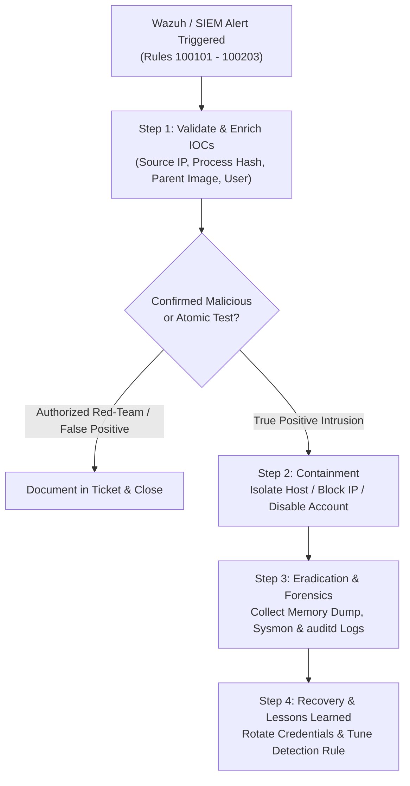

# SOC Incident Triage Playbook (Wazuh SIEM + Sysmon + Linux Auditd)

## 1. Alert Triage Workflow

---

## 2. Runbooks by MITRE ATT&CK Technique

### Playbook A — Rule `100101`: Linux SSH Brute-Force (`T1110.001`)
- **Trigger:** 5+ failed `sshd` password attempts within 120 seconds from the same source IP (`level 10`).
- **Triage Verification:**
  1. Query Wazuh for `rule.id:100101` or check `journalctl -u ssh | grep "Failed password"`.
  2. Check if a successful login (`Accepted password`, SID `5715`) followed from the same `srcip`.
- **Containment & Eradication:**
  - Block offending IP via Wazuh Active Response (`firewall-drop`) or `nftables`/`ufw deny from <srcip>`.
  - Enforce SSH key-only authentication (`PasswordAuthentication no` in `/etc/ssh/sshd_config`).

### Playbook B — Rule `100102` & `100202`: Unauthorized Admin Account Creation / Sudo Escalation (`T1136.001`, `T1548.003`, `T1098`)
- **Trigger:** `usermod -aG sudo` on Linux (`100102`) or Windows EventID `4720` / `net user ... /add` + `net localgroup administrators ... /add` (`100202`).
- **Triage Verification:**
  1. Identify the parent process and initiating user (`SubjectUserName` / `auid`).
  2. Verify against Change Management tickets whether the account creation was authorized.
- **Containment & Eradication:**
  - Immediately disable/delete the rogue account (`userdel -r <user>` or `net user <user> /active:no`).
  - Terminate active sessions (`loginctl terminate-user <user>` or `query session` / `logoff`).

### Playbook C — Rule `100201`: Obfuscated / Encoded PowerShell Execution (`T1059.001`, `T1027`)
- **Trigger:** Sysmon EventID `1` where `Image` ends with `powershell.exe` and `CommandLine` contains `-enc`, `-EncodedCommand`, `FromBase64String`, or `IEX`.
- **Triage Verification:**
  1. Base64-decode the payload (`echo <b64> | base64 -d | iconv -f UTF-16LE -t UTF-8`).
  2. Inspect `ParentImage` (e.g., `WINWORD.EXE`, `cmd.exe`, `w3wp.exe`) and check outbound network connections in Sysmon EventID `3` and DNS queries in EventID `22`.
- **Containment & Eradication:**
  - Isolate the Windows endpoint via EDR/Wazuh active response and block any C2 IP/domain extracted from the decoded script.

### Playbook D — Rule `100103` & `100203`: Credential Dumping (`/etc/shadow` & LSASS `comsvcs.dll` MiniDump — `T1003.008`, `T1003.001`)
- **Trigger:** `auditd` read access to `/etc/shadow` by non-PAM process (`100103`) or Sysmon EventID `1`/`10` accessing `lsass.exe` / invoking `comsvcs.dll MiniDump` (`100203`, **Level 15 CRITICAL**).
- **Triage Verification:**
  1. Inspect `GrantedAccess` mask (`0x1fffff` or `0x1410`) and output dump file path (`C:\Users\Public\lsass.dmp`).
- **Containment & Eradication:**
  - **CRITICAL:** Assume all credentials cached on the host are compromised. Isolate the host immediately, delete the `.dmp` file, force password reset + Kerberos TGT revocation for all users logged into the machine, and enable Windows `RunAsPPL` (LSA Protection) and Credential Guard.
