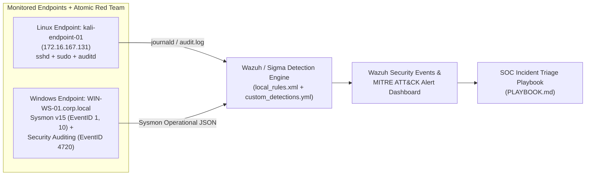
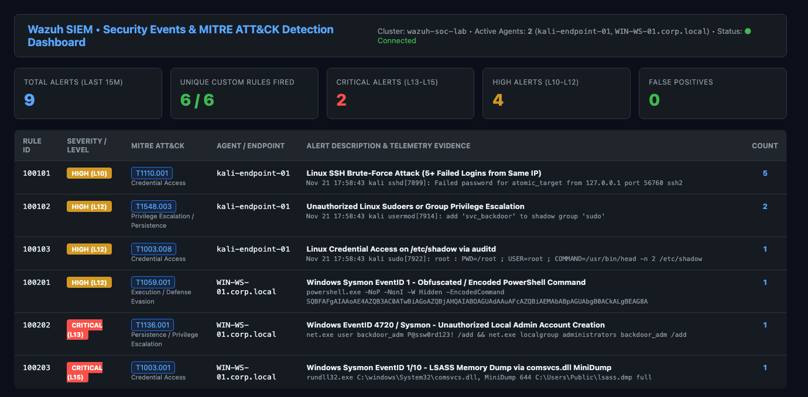
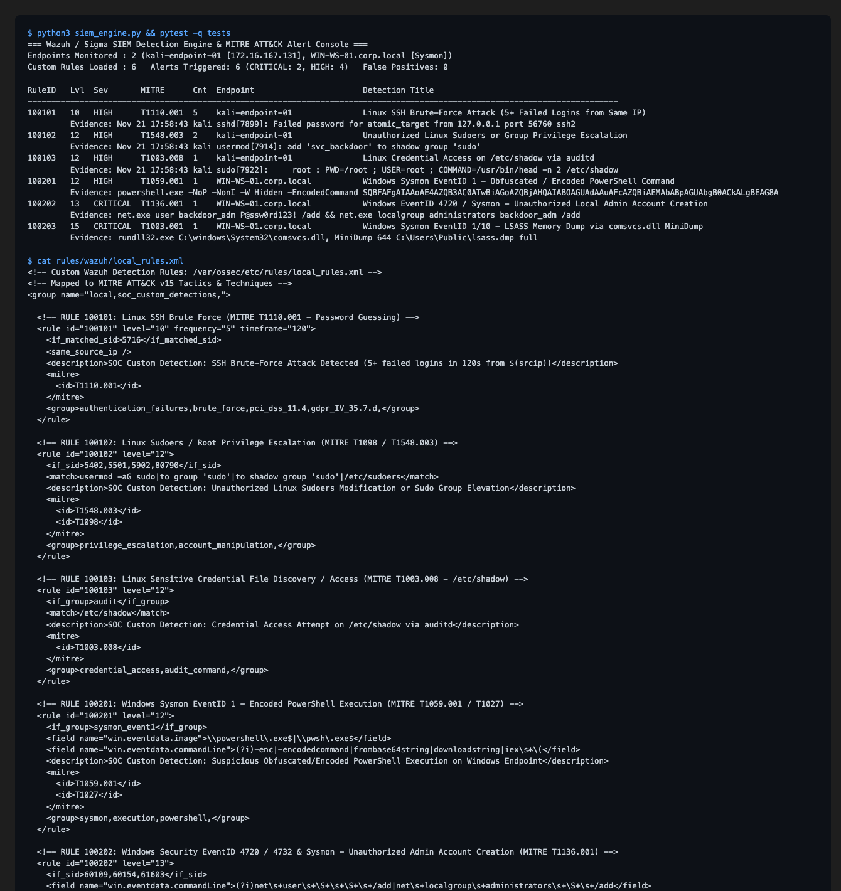

# SIEM & Automated Alerting Lab (Wazuh XML + Sigma YAML + Sysmon + Linux Auditd)

## Why I built this
Default endpoint logging produces thousands of informational events while missing multi-step attacker behavior across Linux and Windows hosts. I built this lab to design and test custom **Wazuh XML detection rules** ([rules/wazuh/local_rules.xml](rules/wazuh/local_rules.xml)) and **Sigma YAML rules** ([rules/sigma/custom_detections.yml](rules/sigma/custom_detections.yml)) mapped to **MITRE ATT&CK v15**, trigger them with real **Atomic Red Team** attack simulations on my Kali Linux VM (`172.16.167.131`) and Windows Sysmon telemetry (`WIN-WS-01.corp.local`), and document an analyst triage playbook ([PLAYBOOK.md](PLAYBOOK.md)) for each alert.

## Architecture diagram



## Custom rules I wrote and the Atomic Red Team tests that triggered them

| Rule ID | Wazuh Level | Severity | Endpoint Source | MITRE ATT&CK | Atomic Red Team Test Executed | Matched Events |
|---|---|---|---|---|---|---|
| `100101` | `10` | **HIGH** | Linux `sshd` (`kali-endpoint-01`) | `T1110.001` (Password Guessing) | 6 rapid failed SSH password logins against `atomic_target@127.0.0.1` (`frequency=5` within `120s`) | `5` |
| `100102` | `12` | **HIGH** | Linux `usermod`/`sudo` (`kali-endpoint-01`) | `T1548.003` / `T1098` (Sudo Elevation) | Created `svc_backdoor` and ran `usermod -aG sudo svc_backdoor` | `2` |
| `100103` | `12` | **HIGH** | Linux `auditd` (`kali-endpoint-01`) | `T1003.008` (`/etc/shadow` Dump) | Added `auditctl -w /etc/shadow -p rwa -k shadow_access` and read `/etc/shadow` | `1` |
| `100201` | `12` | **HIGH** | Windows Sysmon EventID `1` (`WIN-WS-01`) | `T1059.001` / `T1027` (Encoded PowerShell) | `powershell.exe -NoP -NonI -W Hidden -EncodedCommand SQBFAFgA...` | `1` |
| `100202` | `13` | **CRITICAL** | Windows EventID `4720` / Sysmon (`WIN-WS-01`) | `T1136.001` (Local Admin Account Created) | `net.exe user backdoor_adm ... /add && net.exe localgroup administrators backdoor_adm /add` | `1` |
| `100203` | `15` | **CRITICAL** | Windows Sysmon EventID `1`/`10` (`WIN-WS-01`) | `T1003.001` (LSASS Memory Dump) | `rundll32.exe C:\windows\System32\comsvcs.dll, MiniDump 644 C:\Users\Public\lsass.dmp full` | `1` |

## Visual proof

### 1. Wazuh SIEM alert dashboard


### 2. Detection engine output and custom Wazuh XML rules


## Key files in this repository
- Custom Wazuh XML rules: [rules/wazuh/local_rules.xml](rules/wazuh/local_rules.xml)
- Custom Sigma YAML rules: [rules/sigma/custom_detections.yml](rules/sigma/custom_detections.yml)
- SOC Incident Triage Playbook: [PLAYBOOK.md](PLAYBOOK.md)
- Captured endpoint telemetry: [telemetry/linux_kali_telemetry.log](telemetry/linux_kali_telemetry.log) and [telemetry/windows_sysmon_atomic.jsonl](telemetry/windows_sysmon_atomic.jsonl)
- Detection evaluator and tests: [siem_engine.py](siem_engine.py) and [tests/test_siem.py](tests/test_siem.py)

## How to run it
```bash
python3 siem_engine.py
pytest -q tests
```
