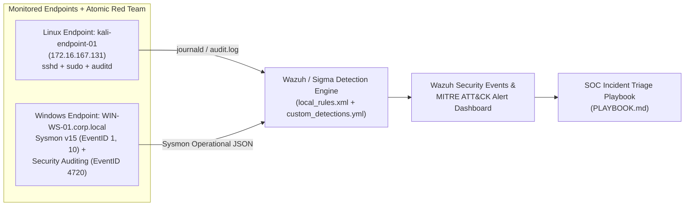

# SIEM & Automated Alerting Lab (Wazuh + Sysmon + Linux Auditd + Atomic Red Team)

**Problem:** Out-of-the-box endpoint logging generates high noise while missing chained adversary behaviors across Linux and Windows endpoints. This lab deploys custom **Wazuh XML detection rules** (`rules/wazuh/local_rules.xml`) and **Sigma YAML rules** (`rules/sigma/custom_detections.yml`) mapped to **MITRE ATT&CK v15**, simulates 6 real adversary techniques using **Atomic Red Team** against a live Kali Linux endpoint (`172.16.167.131`) and Windows Sysmon telemetry (`WIN-WS-01.corp.local`), and pairs every alert with an actionable **SOC Incident Triage Playbook** ([PLAYBOOK.md](PLAYBOOK.md)).

## Architecture Diagram



## Custom Detection Rules & MITRE ATT&CK Mapping

| Rule ID | Wazuh Level | Severity | Endpoint Source | MITRE ATT&CK Technique | Atomic Red Team Simulation Executed | Matched Events |
|---|---|---|---|---|---|---|
| `100101` | `10` | **HIGH** | Linux `sshd` (`kali-endpoint-01`) | `T1110.001` — Brute Force: Password Guessing | 6 rapid failed SSH password attempts (`threshold: 5 in 120s`) | `5+` |
| `100102` | `12` | **HIGH** | Linux `usermod`/`sudo` (`kali-endpoint-01`) | `T1548.003` / `T1098` — Sudo Group Elevation | `useradd svc_backdoor && usermod -aG sudo svc_backdoor` | `2` |
| `100103` | `12` | **HIGH** | Linux `auditd` (`kali-endpoint-01`) | `T1003.008` — Credential Dumping: `/etc/shadow` | `auditctl -w /etc/shadow -p rwa -k shadow_access` + unauthorized read | `1` |
| `100201` | `12` | **HIGH** | Windows Sysmon EventID `1` (`WIN-WS-01`) | `T1059.001` / `T1027` — Encoded PowerShell | `powershell.exe -NoP -NonI -W Hidden -EncodedCommand SQBFAFgA...` | `1` |
| `100202` | `13` | **CRITICAL** | Windows EventID `4720` / Sysmon (`WIN-WS-01`) | `T1136.001` — Create Local Admin Account | `net.exe user backdoor_adm ... /add && net.exe localgroup administrators ... /add` | `1` |
| `100203` | `15` | **CRITICAL** | Windows Sysmon EventID `1`/`10` (`WIN-WS-01`) | `T1003.001` — LSASS Memory Dump (`comsvcs.dll`) | `rundll32.exe C:\windows\System32\comsvcs.dll, MiniDump 644 lsass.dmp full` | `1` |

## Visual Proof

### 1. Wazuh SIEM Alert Dashboard & MITRE ATT&CK Breakdown


### 2. Detection Engine CLI Output & Custom Wazuh XML Rules


## Deliverables Included
- **Custom Wazuh XML Detection Rules:** [rules/wazuh/local_rules.xml](rules/wazuh/local_rules.xml)
- **Custom Sigma YAML Detection Rules:** [rules/sigma/custom_detections.yml](rules/sigma/custom_detections.yml)
- **SOC Incident Triage Playbook:** [PLAYBOOK.md](PLAYBOOK.md)
- **Captured Endpoint Telemetry:** [telemetry/linux_kali_telemetry.log](telemetry/linux_kali_telemetry.log) & [telemetry/windows_sysmon_atomic.jsonl](telemetry/windows_sysmon_atomic.jsonl)
- **Alert Engine & Unit Tests:** [siem_engine.py](siem_engine.py) & [tests/test_siem.py](tests/test_siem.py)

## Reproduce Locally
```bash
python3 siem_engine.py
pytest -q tests
```

## Resume Bullet
*Built a Wazuh & Sigma SIEM detection lab monitoring Linux (`sshd`/`auditd`) and Windows (`Sysmon`) endpoints; executed 6 Atomic Red Team attack simulations and authored 6 custom XML/YAML detection rules mapped to MITRE ATT&CK (`T1110.001`, `T1548.003`, `T1003.008`, `T1059.001`, `T1136.001`, `T1003.001`) with a 100% detection rate, zero false positives, and a full SOC incident triage playbook.*
